# Gestão RM: gestão de frota, pessoas e financeiro (demonstração)

Aplicação web completa para a gestão operacional de uma empresa de engenharia: veículos, multas, rastreadores, manutenção, colaboradores e segurança do trabalho, contratos e finanças. Tudo roda num único processo Node.js, sem etapa de build.

> [!IMPORTANT]
> **Esta é uma versão de demonstração com dados 100% fictícios.** As empresas (Norte Engenharia, Sul Empreendimentos e Delta Energia), as pessoas, placas, CPFs, CNPJs, contratos e valores foram inventados por um gerador de dados ([`scripts/seed-mock.js`](scripts/seed-mock.js)). É uma cópia de portfólio de um sistema que está em uso real, mas **nenhum dado de produção faz parte deste repositório**. O domínio usado nos exemplos é `gestao.example.com`.

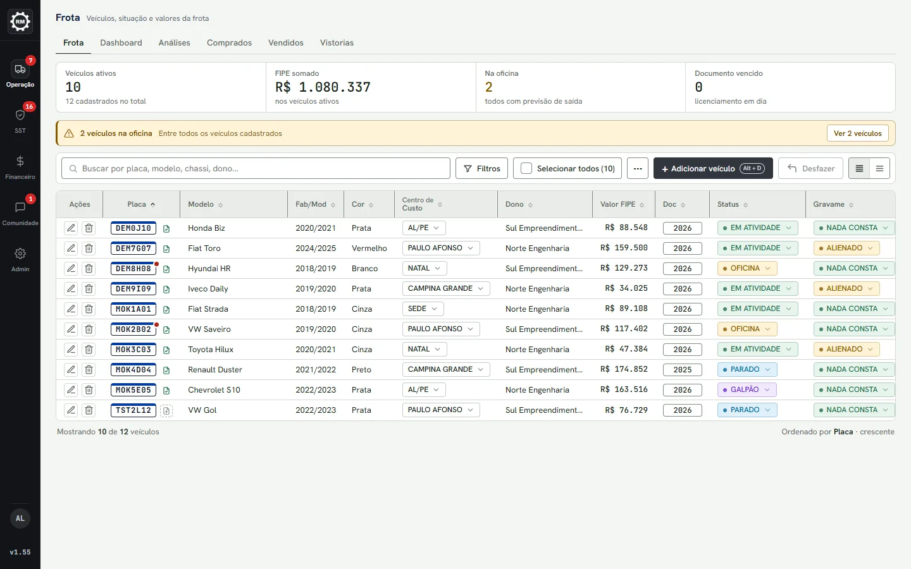

<table>
  <tr>
    <td width="50%">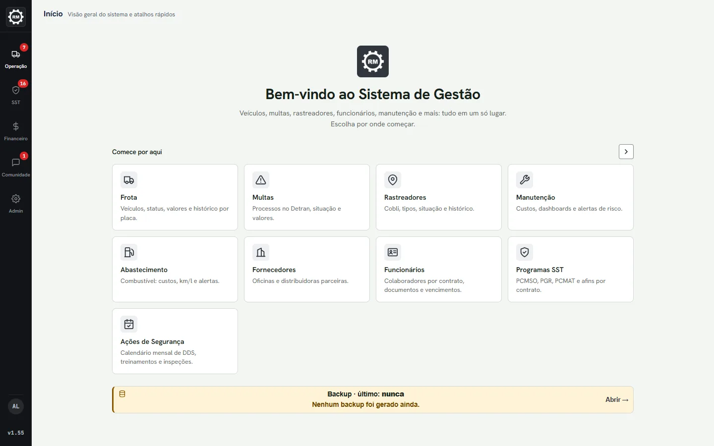</td>
    <td width="50%">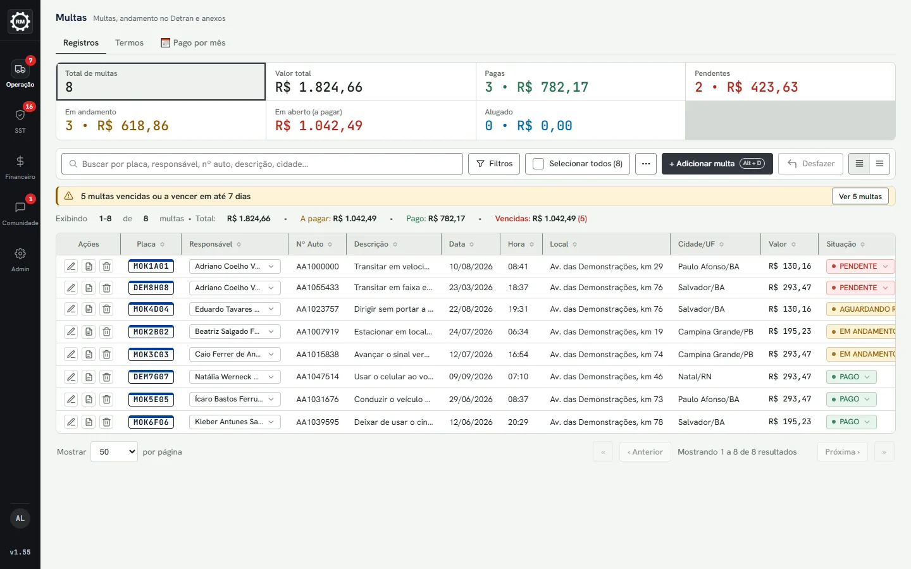</td>
  </tr>
  <tr>
    <td>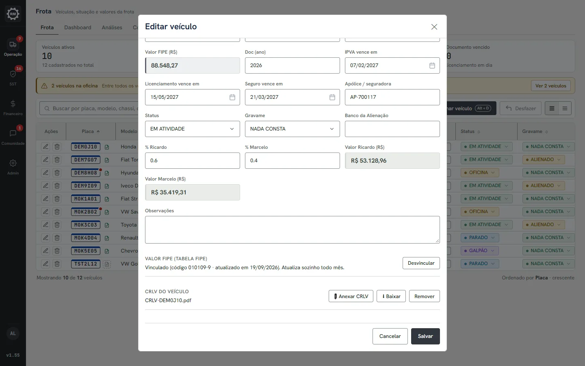</td>
    <td>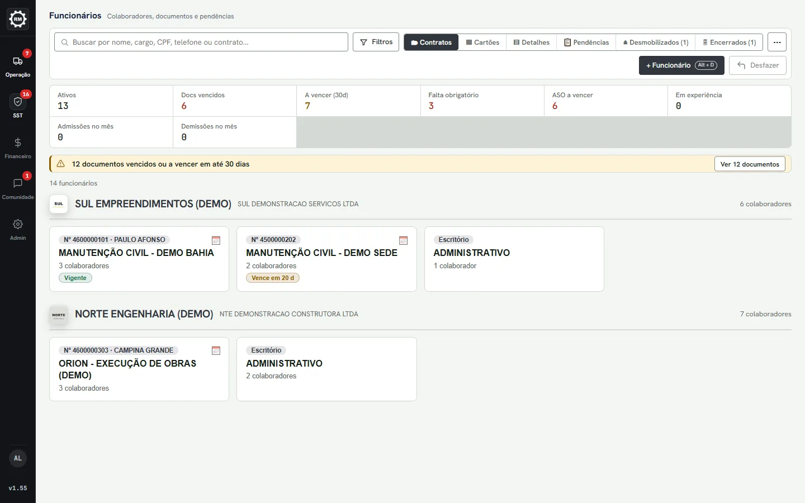</td>
  </tr>
  <tr>
    <td>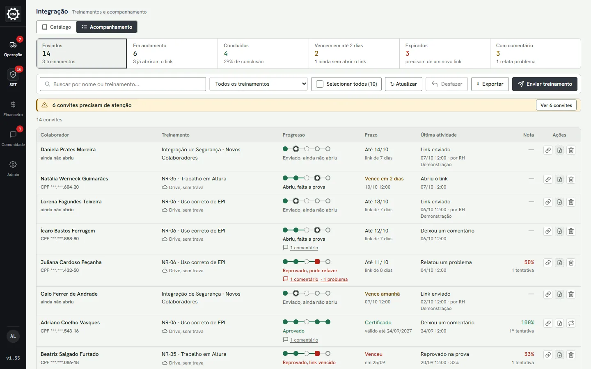</td>
    <td>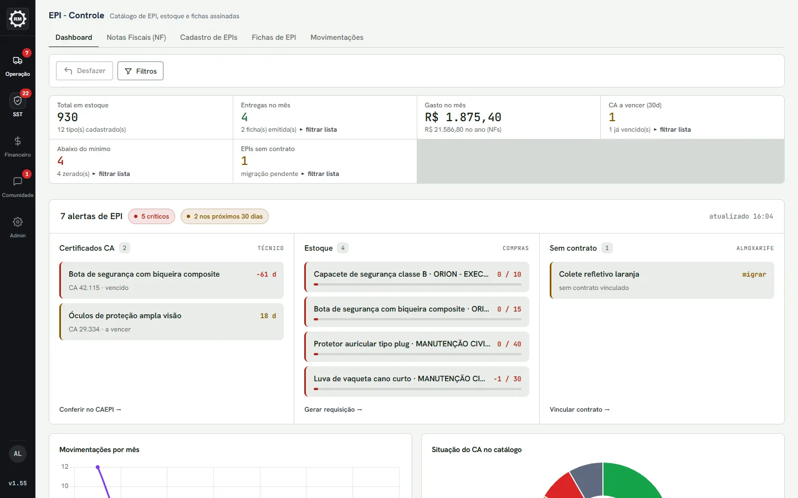</td>
  </tr>
  <tr>
    <td>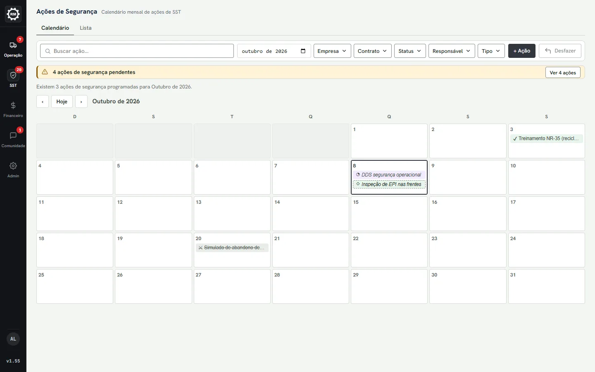</td>
    <td>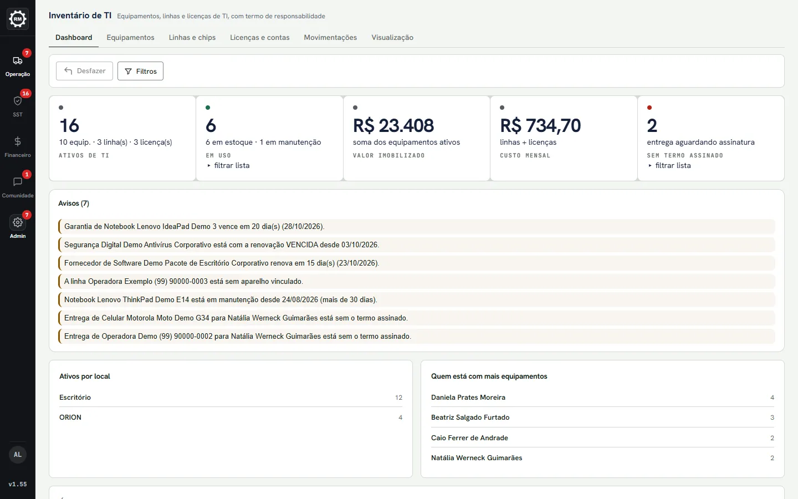</td>
  </tr>
  <tr>
    <td>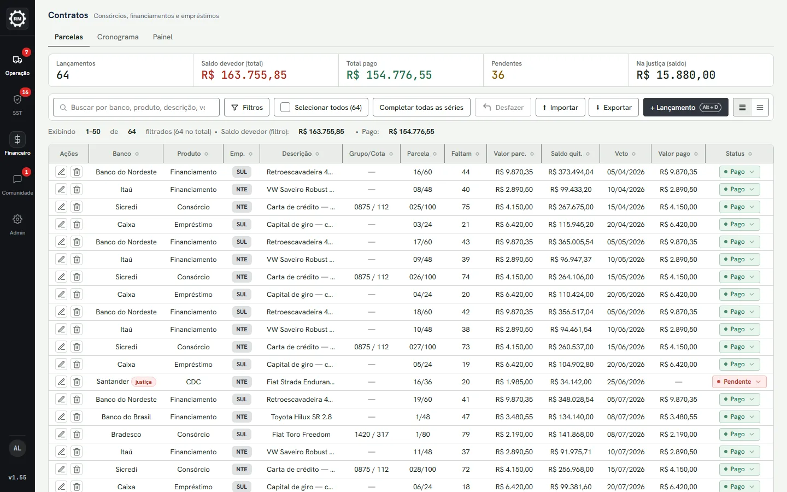</td>
    <td>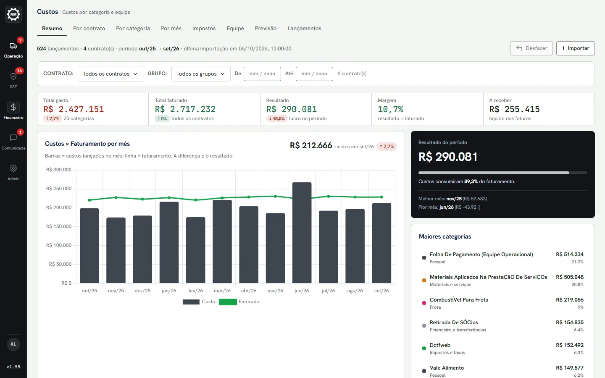</td>
  </tr>
  <tr>
    <td>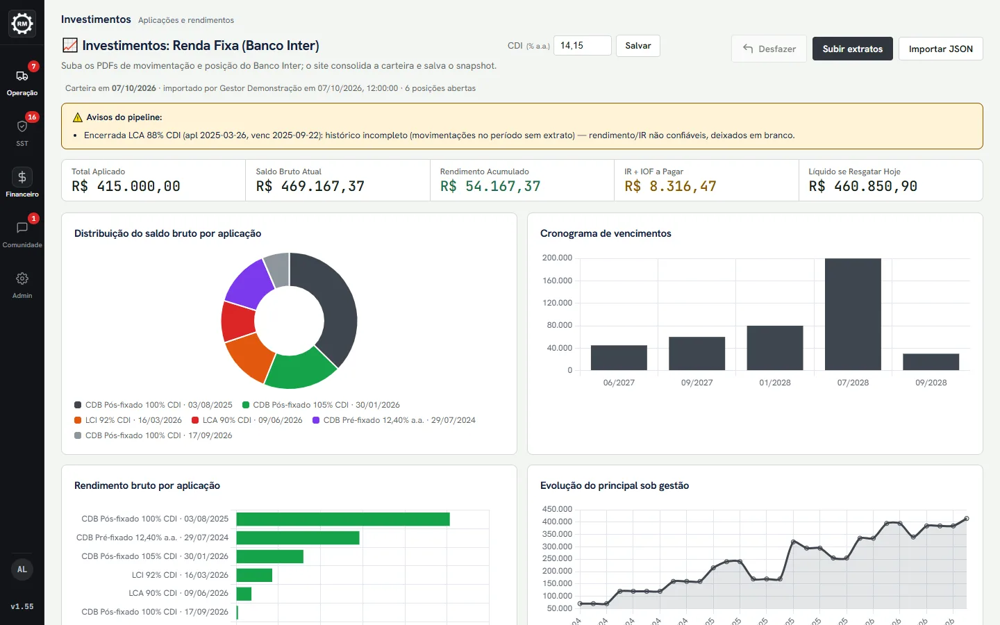</td>
    <td>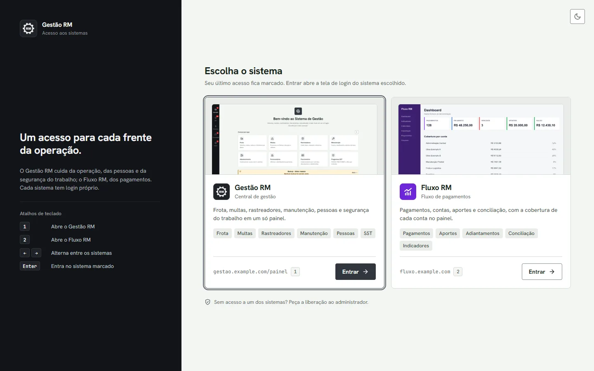</td>
  </tr>
</table>

## Sumário

- [O que o sistema faz](#o-que-o-sistema-faz)
- [Destaques técnicos](#destaques-técnicos)
- [Começando em 5 minutos](#começando-em-5-minutos)
- [Como os dados fictícios são gerados](#como-os-dados-fictícios-são-gerados)
- [Arquitetura](#arquitetura)
- [Configuração](#configuração)
- [Testes e qualidade](#testes-e-qualidade)
- [Deploy](#deploy)
- [Scripts utilitários](#scripts-utilitários)
- [Documentação adicional](#documentação-adicional)
- [Convenções para contribuir](#convenções-para-contribuir)
- [Segurança](#segurança)
- [Licença](#licença)
- [Autor](#autor)

---

## O que o sistema faz

O painel é organizado numa barra lateral por grupos. Cada aba é uma área de permissão própria (ver [Administração](#administração)).

<details>
<summary><b>Glossário</b>: siglas e termos brasileiros de frota, RH e segurança do trabalho usados abaixo</summary>

| Termo | O que é |
| --- | --- |
| **ART** | Anotação de Responsabilidade Técnica: registro, no conselho profissional, de quem responde tecnicamente por um serviço. |
| **CA** | Certificado de Aprovação: número que o Ministério do Trabalho dá a cada modelo de EPI e que tem validade. |
| **CAEPI** | Base pública do Ministério do Trabalho com todos os CAs e suas validades. |
| **Cobli** | Plataforma comercial de rastreamento veicular, com API própria. |
| **CRLV** | Certificado de Registro e Licenciamento de Veículo: o documento anual do veículo. |
| **DDS** | Diálogo Diário de Segurança: conversa curta com a equipe antes do trabalho. |
| **Detran** | Órgão estadual de trânsito, que notifica a multa e recebe a indicação do condutor responsável. |
| **DRE** | Demonstração do Resultado do Exercício (receitas, custos e lucro do período). |
| **EPI** | Equipamento de Proteção Individual (capacete, luva, botina etc.). |
| **FIPE** | Tabela de preço médio de veículos usados, referência de mercado no Brasil. |
| **Gravame** | Restrição no registro do veículo (por exemplo, alienação a um banco num financiamento). |
| **IPCA** | Índice oficial de inflação, usado no reajuste anual das locações. |
| **PCMSO** / **PGR** | Programa de Controle Médico de Saúde Ocupacional e Programa de Gerenciamento de Riscos, obrigatórios por lei. |
| **SST** | Saúde e Segurança do Trabalho. |

</details>

### Operação

- **Frota.** Tabela editável de veículos com busca por placa, modelo, chassi e dono e filtros de seleção múltipla (status, gravame, centro de custo, dono, modelo). Selecionar linhas mostra o FIPE total e a parte de cada sócio, e exporta só os selecionados para Excel. Sub-abas: Dashboard (gráficos de alienação, centro de custo e responsável), Análises (por modelo e versão), Comprados, Vendidos e **Vistorias** (saída e retorno do veículo, com checklist de 11 itens, fotos e aceite do termo).
  - O botão **⟳ FIPE** consulta a tabela FIPE por um proxy no servidor, vincula os veículos compatíveis e atualiza o valor. Depois da primeira sincronização manual, o servidor repete a atualização a cada cerca de 30 dias.
  - O CRLV fica anexado ao veículo (PDF ou imagem), e um ícone ao lado da placa mostra se ele está lá.
  - Toda alteração gera histórico por campo, no formato "antes → depois", consultável pela placa.
- **Multas.** Indicadores por situação (total, valor, pagas, pendentes, em andamento, em aberto, alugado), todos clicáveis como filtro, exceto o valor total; acompanhamento do processo no Detran em quatro etapas (cada uma com data e observação) e anexos por categoria (notificação, boleto, comprovante etc.), com histórico de versões e download em `.zip`.
  - **Preencher por print:** OCR da imagem da multa feito no próprio navegador, com conferência opcional campo a campo.
  - **Gerar termo:** preenche um modelo `.docx` de termo de responsabilidade com os dados da multa, do condutor e do veículo, e oferece o download em Word ou a impressão em PDF.
- **Rastreadores.** Cadastro por Código/ID e ESN, tipos (Instalado, Removível, Outros), importação por planilha com prévia, edição e desativação em lote, e o histórico de vínculos de cada aparelho (em que placa esteve e quando). A sincronização com a API da Cobli é opcional e fica desligada sem `COBLI_API_KEY`.
- **Instalações.** Registro da instalação de rastreadores nos veículos (data, responsável, local e fotos) e dos envios de aparelhos por transportadora, com código de rastreio, status e comprovantes.
- **Manutenção.** Eventos de manutenção com dashboards (custo por veículo, por centro de custo, por modelo, corretiva × preventiva, evolução mensal), alertas de recorrência (Crítico, Atenção ou Normal, comparando cada veículo com a média da frota), notas fiscais de serviço, relatório em PDF por placa e a sub-aba **Odômetro** (leituras do painel, km rodados e alertas de leitura suspeita).
- **Abastecimento.** Transações de combustível por veículo, dashboards e alertas de consumo fora do padrão, odômetro que voltou, sobrepreço do litro, tanque excedido e possíveis duplicados.
- **Fornecedores.** Oficinas, distribuidoras, concessionárias e outros numa tabela com busca, filtros (categoria, tipo, cidade, UF), importação e exportação em Excel e uma ficha com contato, classificação, frota atendida e histórico. O sistema aponta pendências cadastrais na hora (sem CNPJ, incompleto, suspeita de duplicidade).
- **Locações.** Veículos, equipamentos e ferramental alugados a terceiros. A fatura mensal em PDF segue o ciclo do dia 15 ao dia 14, com pró-rata para quem chegou dentro do ciclo, reajuste anual pelo IPCA (que pode ser desligado por item) e histórico de cada fatura emitida.

### Pessoas e Segurança do Trabalho

- **Funcionários.** Ficha do colaborador em 8 abas (pessoais, profissional, contrato, remuneração, CNH, documentos, EPI/itens e observações), seis modos de visualização e a visão **Pendências**, com documentos vencidos e a vencer em ordem de urgência. Em "⚙ Obrigatórios" se monta uma matriz de documentos exigidos por cargo e por contrato.
- **Form. Admissão.** O RH gera um link público, de uso único e com prazo, e o candidato preenche dados pessoais, documentos, dependentes e fardamento sem login. Depois, "Aplicar ao cadastro" leva os dados para a ficha preenchendo só o que estiver vazio.
- **Integração (treinamentos).** Cada convite liga um colaborador a um treinamento por um link. A pessoa confirma o CPF, assiste ao vídeo e faz a prova, que é corrigida no servidor. A aprovação gera sozinha um certificado em PDF com validade, que entra nos documentos do colaborador. A sub-aba Acompanhamento mostra o progresso de cada convite por etapa.
- **Programas SST.** PCMSO, PGR e programas semelhantes por contrato, com validade, responsável técnico, ART e o documento anexado.
- **EPI - Controle.** Cadastro de EPI com CA e validade do CA, notas fiscais, fichas de entrega assinadas na tela (ou a distância, por link) e movimentações. O estoque e a data da próxima troca são calculados a partir das movimentações. A validade do CA pode ser consultada na base pública CAEPI.
- **Almoxarifado.** Cada retirada é um recibo assinado pelo colaborador na tela, com fotos da entrega tiradas pela câmera da própria página e devolução parcial por quantidade.
- **Ações de Segurança.** Controle mensal de DDS, treinamentos e inspeções em calendário e em lista, com status calculado (Programada, Em andamento, Atrasada, Realizada, Cancelada) e evidências anexadas.

### Financeiro

- **Simulador.** Compara financiamento, empréstimo e consórcio pelo **CET** (Custo Efetivo Total) e dá um veredito (bom negócio, aceitável, ruim). As propostas salvas viram um comparador ordenado pelo menor CET.
- **Contratos.** Consórcios, financiamentos e empréstimos lançados parcela a parcela, com cronograma mês a mês, painel de atrasos e exportação para Excel com formatação. "Completar todas as séries" cria as parcelas que faltam sem alterar nenhuma linha existente.
- **Cartões.** Guarda só a marca, os 4 últimos dígitos e o portador. Não há campo para número completo, validade ou CVV.
- **Controles.** Aportes (com rendimento calculado na tela), empréstimos, percentuais por nota fiscal e retiradas entre os sócios fictícios.
- **Contabilidade.** Lê PDFs de DRE, Balanço e Faturamento. Se não encontrar texto, roda OCR num processo separado. Os valores passam por uma prévia de revisão antes de virar indicador.
- **Investimentos.** Carteira de renda fixa montada a partir de extratos em PDF (por um pipeline em Python) ou de JSON, com rendimento diário projetado só em dias úteis.
- **Custos.** Importa uma planilha de razão e mostra custos por contrato, categoria e mês, impostos, equipe (folha e horas extras, só em totais) e previsão de 3, 6 ou 12 meses.

### Administração

- **Senhas.** Cofre de credenciais cifradas com AES-256-GCM. A listagem nunca traz a senha, e cada vez que alguém revela uma ela fica registrada na auditoria.
- **Documentos da empresa.** Arquivos institucionais organizados em pastas, com categoria e validade.
- **Inventário de TI.** Equipamentos, linhas e licenças, com termo de responsabilidade assinado na entrega e na devolução.
- **Cadastros.** Centros de custo, entidades (responsáveis) e motoristas. Renomear um item atualiza os registros que o usam, e um item em uso não pode ser excluído.
- **Usuários e permissões.** Níveis comum, admin e dev. Para usuários comuns, cada aba tem a permissão editar, ver ou nenhum, e o acesso a pessoas pode ser recortado por empresa e por contrato. Mudanças de permissão chegam ao navegador na hora, sem recarregar.
- **Segurança.** Painel só para admin e dev, com logs, sessões ativas, bloqueios de IP, a lista de rotas da API com a guarda que protege cada uma e as configurações de sessão.
- **Backup e restauração.** `.zip` com manifesto e SHA-256 de cada arquivo, restauração com prévia e frase de confirmação, e histórico das cópias.
- **Desfazer.** Pilha de até 20 operações por usuário e por aba, válida por 15 minutos.
- **Feedback.** Mural de sugestões e problemas com imagens, apoio por 👍 e status definido pelo admin.

---

## Destaques técnicos

O que costuma interessar a quem lê o código:

- **Monólito sem build.** Um processo Node serve a API REST, o painel (SPA em JavaScript puro) e as páginas públicas. `npm start` e pronto.
- **Dois modos de persistência no mesmo código.** Sem `MONGODB_URI` os dados ficam em JSON local, com escrita atômica (`.tmp` + `rename` + cópia `.bak`). Com ela, o MongoDB é usado com um cache em memória. Não é preciso instalar banco para desenvolver.
- **OCR de multas 100% no navegador.** Tesseract.js carregado sob demanda e um interpretador puro ([`frontend/multa-ocr.js`](frontend/multa-ocr.js)) que roda também no Node para testes. Ele lê rótulos, posições e a confiança de cada palavra, corrige caracteres confundidos e confere a placa com a frota. Um benchmark com prints fictícios (`npm run avaliar:ocr`) falha se algum campo sair errado.
- **Termo `.docx` vira PDF sem LibreOffice.** O servidor preenche o modelo com docxtemplater e o navegador renderiza o resultado num iframe *sandbox* sem scripts, pronto para "Salvar como PDF".
- **Assinatura eletrônica com prova de integridade, sem serviço externo.** Recibos do Almoxarifado, fichas de EPI e termos de TI guardam o SHA-256 do conteúdo assinado, o IP, o aparelho e a data. Se o documento for editado depois, aparece "⚠ alterado". Um código `XXXX-XXXX-XXXX` com QR leva à página pública `/verificar`, que confere a autenticidade sem login e sem expor CPF.
- **Números calculados, nunca gravados.** Estoque de EPI, situação do CA, próxima troca, situação dos ativos de TI, status das ações de SST e situação das retiradas saem dos eventos registrados. O saldo sempre fecha com o extrato.
- **O mesmo código no navegador e no servidor.** [`frontend/odometro-calc.js`](frontend/odometro-calc.js) é um módulo UMD usado pela tela e pela exportação em Excel, então os dois números nunca divergem.
- **Treinamento com vídeo travado dos dois lados.** O player não deixa pular nem acelerar, e o servidor só libera a prova depois de 95% da duração. O vídeo sobe em partes, sem estado no servidor, com a assinatura AWS SigV4 escrita no próprio projeto (sem `aws-sdk`) e testada com os vetores oficiais.
- **Desfazer seguro.** Cada operação é comparada registro a registro por hash. Se outra pessoa alterou o mesmo registro depois, o Desfazer recusa com 409 em vez de sobrescrever.
- **Backup que não esquece módulo.** A cobertura do backup tem uma fonte única, e a geração falha se surgir um módulo novo sem entrada nela, em vez de deixá-lo de fora em silêncio.
- **Tempo real por Server-Sent Events.** Dados alterados, permissões e avisos chegam a todos os navegadores abertos, sem polling.
- **Segurança em camadas, em Node puro.** CSP sem script inline, anti-CSRF por origem, limite de requisições por IP e no login, sessões assinadas com HMAC e revogáveis, uploads validados pelos *magic bytes* e proteção contra injeção de fórmula nas planilhas exportadas.
- **Cálculo financeiro de verdade.** O CET do Simulador é a TIR mensal do fluxo de caixa (Newton-Raphson com bisseção de reserva), sobre o valor líquido recebido e com a carência no fluxo.
- **Cliente de rede escrito à mão.** Um cliente FTP sobre o módulo `net` do Node baixa a base pública de CA do Ministério do Trabalho uma vez por dia.

---

## Começando em 5 minutos

### Pré-requisitos

- **Node.js 20.19 ou mais recente** (o CI usa Node 20).
- Git.
- Opcional: **Python 3** com `pdfplumber` e `openpyxl` (só para importar extratos na aba Investimentos; ver [`pipeline_rendafixa/requirements.txt`](pipeline_rendafixa/requirements.txt)).

### Subir com a base fictícia

Os comandos são os mesmos no PowerShell e no bash:

```bash
git clone https://github.com/Juan3403/gestao-frota-demo.git
cd gestao-frota-demo
npm ci
node scripts/seed-mock.js --apply --limpar
npm start
```

> [!NOTE]
> O pacote `xlsx` vem de um *tarball* do CDN da SheetJS, e não do registro do npm. Versões recentes do npm recusam esse tipo de origem por padrão e o `npm ci` para com `npm error code EALLOWREMOTE`. Nesse caso, use `npm ci --allow-remote=all`. O aviso `install scripts blocked ... tesseract.js` que pode aparecer depois pode ser ignorado: esse script só exibe um convite a doações, e o sistema e os testes funcionam sem ele.

Abra no navegador:

| Endereço | O que abre |
| --- | --- |
| `http://localhost:3000/` | Hub de acesso, com um cartão por sistema. O cartão "Fluxo RM" é ilustrativo e aponta para um sistema que não faz parte deste repositório. |
| `http://localhost:3000/painel` | O painel. Cada aba tem o próprio endereço, como `/painel/multas`, então recarregar, voltar e compartilhar o link funcionam. |
| `http://localhost:3000/verificar` | Conferência pública de documentos assinados (recibo, ficha de EPI, termo de TI). |

Se a porta 3000 já estiver ocupada, o servidor avisa e não sobe. Escolha outra com `PORT` (PowerShell: `$env:PORT = "3010"; npm start`; bash: `PORT=3010 npm start`) e abra `http://localhost:3010`.

Para desenvolver, `npm run dev` reinicia o servidor sozinho ao salvar o backend. Mudanças em `frontend/` aparecem com F5.

No Windows existe também o atalho `INICIAR.bat`, que sobe o servidor na porta **3001**. Ele não gera a base fictícia e roda `npm install` sem `--allow-remote=all`, então, num clone novo, rode antes os comandos acima (`npm ci --allow-remote=all` e o seed); senão o painel abre vazio ou nem sobe.

### Modo aberto e modo com login

Do jeito acima, sem `SENHA_ADMIN` (ou o nome antigo `APP_PASSWORD`) nem `MONGODB_URI`, o **login fica desligado**: o painel abre direto, com permissão de edição em todas as abas. É o jeito mais rápido de conhecer o sistema.

Para testar os perfis e as permissões, suba com uma senha de admin definida. Qualquer valor serve. Os comandos abaixo também definem a chave do cofre da aba **Senhas** e refazem a base com ela (o seed apaga e recria `data/`), para que as 7 credenciais fictícias continuem abrindo:

```powershell
# PowerShell
$env:COFRE_CHAVE = "chave-demo"; node scripts/seed-mock.js --apply --limpar
$env:SENHA_ADMIN = "qualquer-senha"; npm start
```

```bash
# Linux / macOS
export COFRE_CHAVE=chave-demo
node scripts/seed-mock.js --apply --limpar
SENHA_ADMIN=qualquer-senha npm start
```

Agora `/painel` redireciona para `/login`. A senha definida em `SENHA_ADMIN` é a do **admin mestre**, que entra com o usuário `juan` (troque com `ADMIN_USUARIO`). Os usuários abaixo entram com a senha **`demo1234`**:

| Usuário | Nível | O que pode fazer |
| --- | --- | --- |
| `dev.demo` | dev | Tudo (super-admin, mesmos poderes de admin). |
| `gestor.demo` | admin | Tudo, inclusive Usuários, Segurança e Backup. |
| `operacao.demo` | comum | Edita Frota, Multas, Rastreadores e Feedback; só visualiza Manutenção, Abastecimento e Fornecedores. As demais abas ficam ocultas. |
| `sst.demo` | comum | Edita EPI, Almoxarifado, Ações de Segurança e Feedback; só visualiza Funcionários. Vê as duas empresas. |
| `leitura.demo` | comum | Vê todas as abas sem poder editar. Serve para testar a trava de edição. |
| `novato.demo` | comum | Cadastro **pendente de aprovação**. O login é recusado até um admin aprovar na tela de Usuários. |

Com o login ligado:

- Defina também `SESSION_SECRET`. Sem ela, um segredo novo é gerado a cada reinício e todos são deslogados.
- A aba **Senhas** exige `COFRE_CHAVE`. As credenciais são cifradas na hora do seed, então ele e o servidor precisam usar a **mesma** chave, como nos comandos acima. Se a base foi gerada sem chave (o caminho do "Subir com a base fictícia"), a lista aparece, mas revelar uma senha responde "Configure COFRE_CHAVE"; refaça o seed com a chave definida. No modo aberto nada disso é preciso: seed e servidor usam a mesma chave fixa de desenvolvimento.

### Refazer a base fictícia

```bash
node scripts/seed-mock.js                    # dry-run: mostra o que faria, não grava nada
node scripts/seed-mock.js --apply --limpar   # apaga data/ (com cópia de segurança) e gera tudo de novo
node scripts/seed-mock.js --apply --seed 7   # outra amostra, com outra semente
```

### Acesso à internet

O sistema roda offline, mas algumas funções usam a rede: Chart.js, Tesseract.js e as fontes vêm de CDN; o botão ⟳ FIPE usa uma API pública; e, cerca de 90 s depois de iniciar, o servidor tenta baixar a base pública de CA de EPI (e repete uma vez por dia). Uma falha nessa consulta aparece só no log.

---

## Como os dados fictícios são gerados

[`scripts/seed-mock.js`](scripts/seed-mock.js) gera toda a pasta `data/` a partir de uma semente (padrão `42`):

- **É reproduzível.** A mesma semente gera sempre os mesmos registros (nomes, placas, valores). Só as datas acompanham o dia em que o script roda, para que os cenários "vencido" e "a vencer" não envelheçam.
- **É extensível.** O script principal carrega, em ordem alfabética, os módulos de [`scripts/seed-mock/`](scripts/seed-mock): `10-financeiro`, `20-operacao`, `30-pessoas` e `40-senhas`. Cada um recebe o contexto e devolve `{ 'arquivo.json': conteudo }`. Se um módulo falhar, o script termina com erro.
- **Gera anexos de verdade.** PDFs, fotos, assinaturas e `.docx` (cerca de 260 arquivos) vão para o cofre de anexos local.
- **Assina com o hash certo.** As assinaturas são geradas com o mesmo cálculo que o servidor usa para conferir, então nenhum documento nasce marcado como "⚠ alterado", e `/verificar` confirma os códigos.
- **Nunca toca em banco.** O script só grava arquivos locais e aborta se `MONGODB_URI` estiver definida. Ele respeita `DATA_DIR`, com a mesma regra do servidor.
- **Não inventa auditoria.** Os logs de acesso e de segurança nascem vazios de propósito.
- **Preserva o que é público.** O `--limpar` mantém o índice público de CA de EPI já baixado.

Ordem de grandeza da base com a semente padrão: 12 veículos, 8 multas, 10 rastreadores, 20 manutenções, 30 abastecimentos, 122 leituras de odômetro, 8 fornecedores, 8 locações, 14 colaboradores (empresas NTE e SUL), 12 EPIs com 21 movimentações, 6 retiradas de almoxarifado, 10 ações de segurança, 13 programas SST, 18 ativos de TI, 64 lançamentos de contrato e 524 lançamentos de custos.

---

## Arquitetura

### Stack

| Camada | Tecnologia |
| --- | --- |
| Servidor | Node.js + Express, com compressão gzip/brotli (`compression`) e upload via `multer` |
| Front-end | HTML, CSS e JavaScript puro, sem framework e sem build; PWA instalável |
| Persistência | Arquivos JSON locais ou MongoDB (`mongodb`) |
| Planilhas | `xlsx` (importar e exportar) e `exceljs` (Excel formatado do cronograma de Contratos) |
| PDF | `pdf-lib` (gera recibos, fichas, faturas, relatórios), `pdf-parse` (lê texto), PDF.js no navegador |
| Documentos Word | `docxtemplater` + `pizzip` no servidor; `docx-preview` + JSZip no navegador |
| Backup | `archiver` (cria o `.zip`) e `yauzl` (lê com proteção contra *path traversal*) |
| OCR | Tesseract.js 5.1.1 no navegador (multas); Tesseract.js + `pdf-to-img` + `sharp` no servidor (PDFs contábeis) |
| Gráficos | Chart.js 4.4.1 |
| Testes | `node --test` (nativo) e Playwright (navegador) |

### Estrutura de pastas

```
backend/
  server.js              API REST, regras de negócio e servidor dos estáticos
  cofre-midia.js         cofre de anexos em bucket S3 compatível (opcional)
  videos-treino.js       vídeos de treinamento: envio em partes e assinatura SigV4
  odometro.js            leitura e validação das planilhas de odômetro
  rastreador-vinculos.js histórico de vínculos rastreador ↔ placa
frontend/
  index.html, app.js     o painel (SPA)
  design-system/         Design System oficial (tokens --ds-* e componentes)
  design-*.css           ajustes por módulo; design-mobile.css para telas < 768 px
  styles.css             CSS legado, mantido por compatibilidade
  login, admissao, treinamento, verificar, assinar-epi   páginas públicas (.html + .js); 404.html
  multa-ocr.js           interpretador do OCR de multas (navegador e Node)
  odometro-calc.js       cálculo de km (navegador e servidor)
  sw.js, manifest.webmanifest   service worker e manifesto do PWA
  modelos/               modelos de PDF (fichas de EPI das empresas fictícias)
hub/                     página de acesso servida em /
config/                  catálogo de empresas e contratos da aba Funcionários
scripts/                 seed, backup/restauração, segurança, capturas de tela e manutenção de dados
test/                    testes de unidade e integração (node --test)
e2e/                     testes de navegador (Playwright)
pipeline_rendafixa/      pipeline em Python dos extratos de renda fixa (aba Investimentos)
docs/                    documentação e prints (docs/img)
docs-vault/              notas sobre os principais módulos e a arquitetura (Obsidian)
CLAUDE.md, AGENTS.md     instruções para assistentes de código (IA) que trabalham no repositório
```

### Persistência nos dois modos

| Modo | Quando | Como guarda |
| --- | --- | --- |
| **Local** | sem `MONGODB_URI` | Um arquivo JSON por módulo em `data/` (ou em `DATA_DIR`), relido a cada requisição. Gravação atômica com cópia `.bak` da versão anterior. |
| **MongoDB** | com `MONGODB_URI` | Banco `frota`, coleção `app`, um documento por módulo. Tudo é carregado em memória no boot; cada gravação pela API atualiza o cache e espera o banco confirmar. |

> [!WARNING]
> No modo MongoDB, alterações feitas **direto no banco** (por script, por exemplo) só aparecem depois de reiniciar o servidor. O que é feito pela interface aparece na hora.

A pasta `data/` inteira fica fora do Git.

### Anexos

Fotos, PDFs e assinaturas vão para um **cofre de anexos**. No modo local cada arquivo vira `data/uploads/<id>.json`; com MongoDB, um documento próprio. Opcionalmente, um bucket compatível com S3 (variáveis `MIDIA_S3_*`) recebe os arquivos novos. A leitura procura primeiro no bucket e depois no armazenamento antigo, e um disjuntor pausa o bucket após 3 falhas seguidas. Se o arquivo não puder ser lido, a resposta é "cofre indisponível" (503), nunca "arquivo apagado". No modo local as `MIDIA_S3_*` são ignoradas, a menos que `MIDIA_S3_LOCAL=1`, para que um teste na sua máquina não mexa num bucket real.

Os vídeos de treinamento têm armazenamento próprio (`VIDEO_S3_*`). Sem configuração, o modo local guarda os vídeos em `data/videos`. Os treinamentos da base fictícia não têm vídeo de verdade: para ver o player travado, envie um vídeo pela tela. Detalhes em [`docs/VIDEOS_TREINAMENTO.md`](docs/VIDEOS_TREINAMENTO.md) e [`docs/ARQUIVOS_R2.md`](docs/ARQUIVOS_R2.md).

### Tempo real

`GET /api/eventos` é um canal de Server-Sent Events. O servidor avisa quando um tipo de dado muda, quando a permissão ou o nível de um usuário muda e quando o modo manutenção é ligado, e o navegador recarrega só o que mudou. Há ping a cada 25 s, no máximo 5 conexões por usuário ou IP, e o canal fica fora da compressão para os eventos não ficarem presos em buffer.

### Rotas do painel e PWA

O painel vive em `/painel`, com rotas por caminho (`/painel/<aba>[/<sub-aba>]`) via History API. Endereços antigos na raiz, como `/frota`, recebem 301 para `/painel/...`. O service worker nunca intercepta `/api/` nem requisições de escrita, busca os estáticos na rede primeiro e só usa o cache offline; apenas `/painel*` vira shell offline.

### Design System

O padrão visual está em [`docs/DESIGN.md`](docs/DESIGN.md) e em [`frontend/design-system/`](frontend/design-system), em 10 arquivos CSS numerados:

- `01-tokens.css` tem só os valores primitivos (`--ds-*`).
- `02-themes.css` traduz esses valores em tokens semânticos (`--ds-surface`, `--ds-ink`, `--ds-primary`...) para os dois temas, claro e escuro.
- Os demais trazem os componentes, que **nunca escrevem cor direto**, só consomem tokens. Por isso o tema escuro não exige CSS duplicado.

O usuário escolhe Claro, Escuro ou Automático (segue o sistema operacional), e o alto contraste é uma camada de acessibilidade independente, aplicada por cima. A fonte da interface é a Hanken Grotesk, e a monoespaçada, a JetBrains Mono. `frontend/styles.css` é legado e não serve de referência para tela nova. O teste `test/design-system.test.js` audita o uso dos tokens.

---

## Configuração

O servidor lê um arquivo `.env` na raiz, se existir; variáveis já definidas no ambiente têm prioridade. Copie [`.env.example`](.env.example) como ponto de partida. **Nenhuma variável é necessária para rodar a demonstração.**

### Principais

| Variável | Padrão | Para quê |
| --- | --- | --- |
| `PORT` | `3000` | Porta HTTP. |
| `DATA_DIR` | `data/` | Pasta dos dados no modo local. |
| `MONGODB_URI` | — | Liga o modo MongoDB (e o login). |
| `SENHA_ADMIN` | — | Senha do admin mestre; liga o login. `APP_PASSWORD` é o nome antigo, ainda aceito. |
| `ADMIN_USUARIO`, `ADMIN_NOME` | `juan` / `Juan` | Login e nome de exibição do admin mestre (o usuário que entra com a `SENHA_ADMIN`). |
| `SESSION_SECRET` | aleatório a cada boot | Assina as sessões. Obrigatória em produção, senão todos são deslogados a cada reinício. |
| `SESSION_INATIVIDADE_MIN` | `60` | Minutos de inatividade até a sessão expirar. |
| `SESSION_ABSOLUTO_H` | `12` | Duração máxima da sessão, em horas. |
| `COFRE_CHAVE` | chave fixa no modo aberto | Chave do cofre da aba Senhas. Obrigatória com login. Não troque depois de cadastrar credenciais. |
| `NODE_ENV` | — | Use `production` em produção. |

### Opcionais

| Variável | Para quê |
| --- | --- |
| `COBLI_API_KEY` | Sincroniza os rastreadores com a API da Cobli. |
| `RESEND_API_KEY`, `NOTIF_EMAIL_PARA`, `NOTIF_EMAIL_DE`, `NOTIF_HORA` | Resumo diário de pendências por e-mail (hora padrão: 7). |
| `PYTHON_BIN` | Interpretador Python usado pelo pipeline de Investimentos. |
| `VIDEO_S3_ENDPOINT`, `VIDEO_S3_REGION`, `VIDEO_S3_BUCKET`, `VIDEO_S3_KEY_ID`, `VIDEO_S3_KEY_SECRET` | Bucket dos vídeos de treinamento (vão todas juntas). |
| `VIDEO_MAX_MB`, `VIDEO_URL_TTL_MIN`, `VIDEO_ORFAO_DIAS` | Tamanho máximo do vídeo (1024), validade da URL de reprodução em minutos (360) e carência antes de apagar vídeo sem uso (90 dias). |
| `MIDIA_S3_BUCKET`, `MIDIA_S3_KEY_ID`, `MIDIA_S3_KEY_SECRET` | Bucket dos anexos (vão juntas). |
| `MIDIA_S3_ENDPOINT`, `MIDIA_S3_REGION` | Endereço e região do bucket de anexos. Vazias, usam as `VIDEO_S3_*` (e a região cai em `auto`). As chaves nunca são herdadas. |
| `MIDIA_S3_LOCAL`, `MIDIA_S3_PAUSA_MS` | Permite o bucket de anexos no modo local; tempo de pausa do disjuntor. |
| `AUDIT_GRAVACOES` | `1` registra as gravações de contratos em `data/gravacoes.log` (diagnóstico). |

`RENDER_GIT_COMMIT` vem da hospedagem, quando ela o fornece, e vira o `build` que dispara o aviso de nova versão; fora dela, o build fica `local-<versão>`.

---

## Testes e qualidade

```bash
npm test                          # 452 testes em 22 arquivos, cerca de 45 s
npx playwright install chromium   # uma vez, antes dos testes de navegador
npm run test:e2e                  # 4 suítes num Chromium real
npm run test:ocr                  # unidade + e2e do OCR de multas (sem rede)
npm run avaliar:ocr               # Tesseract de verdade sobre 7 prints fictícios
npm run security:secrets          # procura segredos nos arquivos versionados
npm run security:audit            # npm audit (nível alto) + busca de segredos
```

- **`npm test`** usa o executor nativo do Node, sem framework. Não precisa de navegador, banco nem internet: cada arquivo sobe o próprio servidor numa pasta temporária e numa porta exclusiva, e um teste garante que as portas não colidem. Há suítes dedicadas a segurança (cabeçalhos, CSRF, cookie, acesso indevido a anexos, uploads perigosos, injeção de fórmula, recorte por empresa), backup, almoxarifado, EPI, vídeos (com os vetores oficiais da SigV4), TI e Design System, entre outras.
- **`npm run test:e2e`** sobe o servidor com login desligado e navega pelo app. Para ver a janela, defina `HEADED=1` (PowerShell: `$env:HEADED = "1"; npm run test:e2e`; bash: `HEADED=1 npm run test:e2e`).
- **`npm run avaliar:ocr`** precisa de internet na primeira vez e falha se algum campo da multa sair errado. `--out <pasta>` guarda os PNGs e o relatório.

### Integração contínua (GitHub Actions)

- **Segurança** ([`security.yml`](.github/workflows/security.yml)): em push e PR para `main`, toda segunda-feira e sob demanda. Roda gitleaks no histórico, o scanner próprio de segredos, `npm ci` com conferência do lockfile, `npm audit --audit-level=high` e `npm test` no Node 20.
- **Versão & changelog** ([`version-check.yml`](.github/workflows/version-check.yml)): exige que a versão do `package.json` e o topo do `CHANGELOG` sejam iguais e que a versão suba quando o código servido muda (ver [Convenções](#convenções-para-contribuir)).
- **Backup para a nuvem** ([`backup-nuvem.yml`](.github/workflows/backup-nuvem.yml)): nesta demonstração só roda manualmente e depende de uma instância no ar e de *secrets* configurados no repositório. Sem isso, não funciona.

---

## Deploy

Qualquer serviço que rode Node.js 20 serve (por exemplo, o Render). Em resumo:

1. Crie um Web Service apontando para o repositório, com o comando de início `npm start`.
2. Defina `MONGODB_URI`, `SENHA_ADMIN`, `SESSION_SECRET` e `COFRE_CHAVE`. O servidor se recusa a subir com login ativo e sem senha de admin.
3. Sirva por HTTPS (o cookie de sessão sai com `Secure` e o HSTS é ligado automaticamente).
4. Python 3 com `pdfplumber` e `openpyxl` só é necessário se você usar a importação de extratos em Investimentos.

O passo a passo, com MongoDB Atlas, está em [`docs/HOSPEDAGEM.md`](docs/HOSPEDAGEM.md). A lista de variáveis acima é a referência mais atual.

---

## Scripts utilitários

Os scripts que gravam dados fazem **dry-run por padrão** e só gravam com uma opção explícita: `--apply` na maioria; no `migrar-midia-r2.js`, `--copiar` e `--apagar-do-mongo`.

| Script | O que faz |
| --- | --- |
| `scripts/seed-mock.js` | Gera a base fictícia em `data/` (ver acima). |
| `scripts/backup.js` / `scripts/restore.js` | Backup e restauração por terminal, no mesmo formato `.zip` da tela, em JSON local ou MongoDB. Cobre os módulos principais; a cópia completa é a do botão Backup. Ex.: `node scripts/backup.js --out ./backups`; `node scripts/restore.js <arquivo.zip>` (dry-run), depois `--apply` e `--modo mesclar` ou `--modo substituir`. |
| `scripts/scan-secrets.js` | Procura segredos nos arquivos versionados e nunca imprime o segredo encontrado. Usa o gitleaks se estiver instalado. |
| `scripts/screenshots.mjs` | Fotografa todas as abas nos temas claro e escuro (1440×900 @2x), num servidor temporário com dados do seed. Ex.: `node scripts/screenshots.mjs --out ./prints --tabs frota,multas`. |
| `scripts/auditoria-design.mjs` | Abre o site e aponta estilos fora dos tokens `--ds-*`. |
| `scripts/avaliar-ocr-multas.js` | Benchmark do OCR (`npm run avaliar:ocr`). |
| `scripts/gen_icons.js` | Regera o favicon e os ícones do PWA. |
| `scripts/trancar-abas-novas.js` | Tranca abas que ficaram liberadas para usuários antigos. |
| `converter-multas-concluidas.js`, `corrigir-series-contratos.js`, `corrigir-vencimentos-series.js`, `limpar_duplicatas_contratos.js` (em `scripts/`) | Correções pontuais de dados. |
| `scripts/diagnostico-*.js` | Diagnósticos somente leitura (armazenamento no MongoDB, cofre da admissão). |
| `scripts/migrar-midia-r2.js` | Migra os anexos do MongoDB para um bucket S3 compatível (ver [`docs/ARQUIVOS_R2.md`](docs/ARQUIVOS_R2.md)). |

> [!TIP]
> Os scripts em `scripts/` resolvem caminhos com `path.join(__dirname, '..', …)`. Ao criar um novo ali, não esqueça o `'..'`: sem ele, o script procura os dados em `scripts/data/` e não dá erro, só não acha nada.

---

## Documentação adicional

| Arquivo | Assunto |
| --- | --- |
| [`docs/COMO_USAR.md`](docs/COMO_USAR.md) | Guia de uso para quem opera o sistema. |
| [`docs/DESIGN.md`](docs/DESIGN.md) | Padrão visual obrigatório: tokens, temas, componentes e exceções registradas. |
| [`docs/RECEITA-FROTA.md`](docs/RECEITA-FROTA.md) | Medidas reais da aba Frota (valores computados × tokens), usada como referência visual. |
| [`docs/HOSPEDAGEM.md`](docs/HOSPEDAGEM.md) | Como publicar o sistema na internet. |
| [`docs/SECURITY.md`](docs/SECURITY.md) | Modelo de ameaça, política de segredos, rotação de credenciais e auditorias. |
| [`docs/SECURITY_ENDPOINTS.md`](docs/SECURITY_ENDPOINTS.md) | Inventário das rotas da API com os controles de cada uma. |
| [`docs/API_INTEGRACAO.md`](docs/API_INTEGRACAO.md) | API sistema a sistema com token de máquina (lista de colaboradores). |
| [`docs/BACKUP_NUVEM.md`](docs/BACKUP_NUVEM.md) | Backup automático para armazenamento de objetos S3 via GitHub Actions. |
| [`docs/VIDEOS_TREINAMENTO.md`](docs/VIDEOS_TREINAMENTO.md) | Vídeos de treinamento em bucket próprio e o player travado. |
| [`docs/ARQUIVOS_R2.md`](docs/ARQUIVOS_R2.md) | Cofre de anexos em bucket S3 compatível e a migração a partir do MongoDB. |
| [`docs/STACKS.md`](docs/STACKS.md) | Visão geral da stack (o `package.json` é a fonte mais atual das dependências). |
| [`pipeline_rendafixa/README.md`](pipeline_rendafixa/README.md) | Pipeline em Python dos extratos de renda fixa. |
| [`docs-vault/`](docs-vault) | Notas sobre os principais módulos e a arquitetura, no formato Obsidian (ponto de partida: [`MOC.md`](docs-vault/MOC.md)). |

---

## Convenções para contribuir

### Versão e CHANGELOG andam juntos

A versão exibida no app vem do `package.json`, e as novidades ficam no array `CHANGELOG` em [`backend/server.js`](backend/server.js). Toda mudança visível em `backend/server.js` ou `frontend/*` precisa, no mesmo commit:

1. subir a versão no `package.json` (normalmente o patch: `x.y.Z` → `x.y.Z+1`);
2. acrescentar uma entrada **no topo** do `CHANGELOG`, com a mesma versão:

```js
{ versao: '1.55.53', data: '08/10/2026', mudancas: ['Frota: o que mudou, na linguagem de quem usa'] }
```

O app lê `/api/versao` e mostra um aviso de nova versão a quem está com a página antiga. A regra é conferida pelo CI e pelo hook local. Ative o hook uma vez por clone:

```bash
git config core.hooksPath .githooks
```

Opcionalmente, acrescente o hook que procura segredos antes de cada commit. Ele precisa ir para `.githooks/`, porque com `core.hooksPath` definido o Git deixa de ler `.git/hooks`:

```bash
cp scripts/pre-commit .githooks/pre-commit && chmod +x .githooks/pre-commit
```

Refatorações e correções internas sem efeito visível podem levar `[sem-versao]` na mensagem do commit.

### Toda funcionalidade nova vem com exemplo de uso

Toda função, endpoint, componente, script ou campo novo vem, **no mesmo commit**, com um exemplo prático em comentário junto do código: como chamar, quais parâmetros entram e o que sai. Quem mexer daqui a seis meses precisa ver o uso na mesma tela em que lê a implementação.

| O que você criou | Onde vai o exemplo | O que ele precisa mostrar |
| --- | --- | --- |
| **Endpoint** (`backend/server.js`) | Comentário logo acima do `app.get/post/put/delete` | Método e rota, corpo/query aceitos, um retorno de sucesso e o erro mais comum. |
| **Função ou helper** | Comentário logo acima da função | Uma chamada real com valores e o que ela devolve. |
| **Componente de tela** (`frontend/app.js`) | Comentário acima da função que renderiza | Como instanciar, as opções e o que aparece na tela. |
| **Script** (`scripts/`) | Bloco `USO` no cabeçalho do arquivo | A linha de comando completa, incluindo `--apply`/dry-run. |
| **Coleção ou campo novo** | Comentário no normalizador | Um registro de exemplo preenchido. |

Exemplo de endpoint documentado do jeito esperado:

```js
// Devolve as retiradas do almoxarifado já com a situação CALCULADA (nunca gravada).
//
// USO:
//   GET /api/almoxarifado   → retiradas visíveis ao usuário (recorte por empresa)
//
// RESPOSTA (200):
//   [{ id: 'ALMxyz', funcionarioNome: 'Fulano', situacao: 'Em posse',
//      itens: [{ nome: 'Furadeira', quantidade: 1, qtdPendente: 1 }] }]
//
// ERROS: 401 sem sessão · 403 sem permissão na área `almoxarifado`
app.get('/api/almoxarifado', exigeVer('almoxarifado'), (req, res) => { /* ... */ });
```

Exemplo de função (ilustrativo):

```js
// Quanto um sócio tem no veículo, a partir do valor FIPE e da fração (0 a 1) dele.
//
// USO:
//   valorDoSocio({ valorFipe: 100000, pct: 0.6 })  // => 60000
//   valorDoSocio({ valorFipe: 100000 })            // => 0  (sem percentual definido)
const valorDoSocio = (v) => (v.valorFipe || 0) * (v.pct || 0);
```

### Design System

Toda tela ou componente novo segue [`docs/DESIGN.md`](docs/DESIGN.md) e os tokens `--ds-*` de [`frontend/design-system/`](frontend/design-system). Cor, raio e sombra sempre por token, nada de valor solto. `frontend/styles.css` é legado e não deve ser usado como referência.

### Outras regras do código

- No servidor, use os helpers de permissão (`exigeVer`, `exigeEditar`, `ehNivelAdmin`) em vez de comparar o nível na mão.
- Uma coleção nova precisa entrar no seed e no backup (cobertura e restauração). Se guardar anexos, também na lista de anexos referenciados, senão a limpeza automática de arquivos órfãos os apaga.
- Rotas fixas (como `/api/x/exportar`) são registradas antes das rotas com `:id`, senão a rota dinâmica as captura.

---

## Segurança

Resumo do que o código faz:

- Senhas de usuário em PBKDF2-SHA256 (100 mil iterações, salt aleatório), conferidas em tempo constante.
- Sessão sem estado no servidor: cookie `HttpOnly`, `SameSite=lax` e `Secure` em HTTPS, assinado com HMAC e revogável (por pessoa ou para todos) sem trocar senha. Expira por inatividade e por tempo máximo.
- Permissões checadas no servidor em cada rota, por aba e por empresa/contrato. Um usuário novo nasce sem acesso a nenhuma aba, e uma aba nova sobe trancada para os usuários existentes.
- Limite de 8 tentativas de login erradas a cada 15 minutos por IP, com mensagem de erro genérica; limite global de 600 requisições por minuto por IP; bloqueio de IPs pela tela.
- CSP sem script inline, `nosniff`, `X-Frame-Options`, `Referrer-Policy` e HSTS em HTTPS. Requisições de escrita exigem origem do próprio site (anti-CSRF).
- Uploads com lista de extensões, limite de tamanho e tipo conferido pelos *magic bytes*. Arquivos que não são imagem ou PDF são sempre baixados, nunca abertos no domínio.
- Exportações para Excel/CSV neutralizam fórmulas (células que começam com `=`, `+`, `-` ou `@`).
- Erros internos nunca devolvem stack: a resposta traz um código curto que aparece também no log.
- Trilhas de auditoria de acesso e de ações sensíveis, sem gravar senha, token ou cookie.

Esta demonstração roda, por padrão, **sem login e com permissão total**. Isso é intencional para o uso local; não exponha a instância à internet assim. Em produção, defina `SENHA_ADMIN`, `SESSION_SECRET` e `COFRE_CHAVE` e use HTTPS. Nunca coloque a `MONGODB_URI` nem outras credenciais em issues, commits ou chats.

**Encontrou uma vulnerabilidade?** Não abra uma issue pública. Fale com o autor pelo [perfil no GitHub](https://github.com/Juan3403) ou, se o botão estiver disponível, pelo relato privado em *Security › Report a vulnerability*. Mais detalhes em [`docs/SECURITY.md`](docs/SECURITY.md).

---

## Licença

Este repositório ainda não tem licença de código aberto. O código está publicado para consulta e estudo; sem uma licença, os direitos de cópia, modificação e redistribuição continuam reservados ao autor. Para outro uso, fale com ele.

---

## Autor

Desenvolvido por **Juan Lucas**: [github.com/Juan3403](https://github.com/Juan3403).

Este repositório é uma cópia de demonstração de um sistema que está em uso real. O código é o do sistema original, com nomes, marcas e configurações trocados por equivalentes fictícios e alguns ajustes próprios da demonstração; os dados, as empresas e as pessoas foram inventados.
